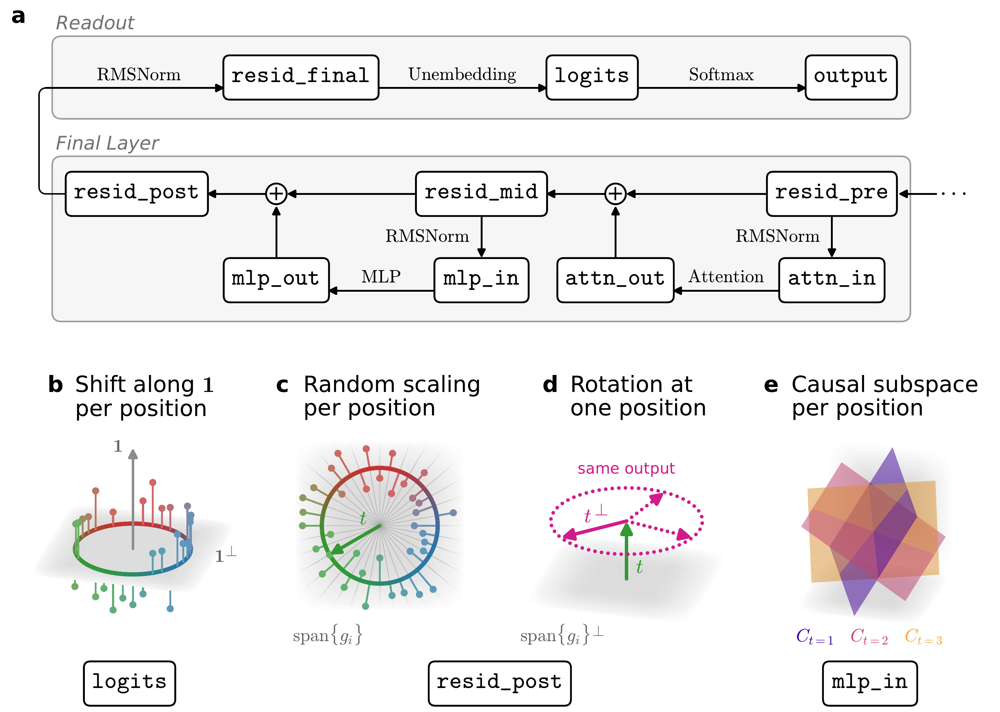

# Pulling Back Causal Subspaces Through a Transformer

[](https://neurips.cc/)

Andrew Jun Lee†, Selma Mazioud, Jasmina Urdshals, Paul M. Riechers, Adam Shai, and Kyle J. Ray†

†Correspondence to andrewlee0@g.ucla.edu or kylejray@gmail.com.

This repository contains the code, the figures, and the analysis notebooks behind the paper, published at the InterpScience workshop at NeurIPS 2026.

## Abstract

To what extent can causal subspaces be derived *a priori* from the transformer architecture? In the case where the vocabulary size is smaller than the residual stream dimension, we show that the causal structure of a transformer's activations, from the logits to the final MLP's input, can be derived from the architecture alone. Based on these derivations, we also interpret what the causal structures represent. However, we find that some of this causal structure is not well described by a single, fixed linear subspace. Moreover, both the derivation and the interpretation of the representation stop at the final MLP's input, where the derived causal structure can span the entire activation space, though a smaller causal subspace can be estimated to first order. We end with empirical evidence for the derived causal structures and the estimated causal subspace of the final MLP's input.



**Figure 1.** (a) The transformer architecture's final layer and readout, which converts the residual stream into next-token output probabilities. Hook names follow TransformerLens, except that `attn_in` and `mlp_in` denote the inputs to attention and the MLP after RMSNorm, and `resid_final` the activation after the final RMSNorm. (b–e) Sketches of the derived causal structure with V = 3 tokens. (b) The RGB circle shows the token positions' centered logits, colored by output, mixing one color per token. Adding c**1** to a token position's logits does not change its output, where we allow c to differ across token positions. (c) At the final layer's `resid_post`, the RGB circle is that of (b) in span{g_i}, up to an invertible linear map set by the g_i. Rescaling a token position by a positive factor does not change the output. Thus, each token position can move along its ray in span{g_i}. (d) With token position t's component in span{g_i} fixed, its component t⊥ in span{g_i}⊥ can rotate freely (dotted) without changing t's output. (e) At the final layer's `mlp_in`, the first-order causal subspace C_t can change across token positions t.

## Setup

```bash
pip install torch numpy matplotlib seaborn jupyter "transformer_lens==2.18.0" "transformers==4.57.6"
```

## Replicating Results

Both figures of the paper are saved in `figures/`. The numbers of Section 3 and of Appendices C, G, and H are printed by the notebooks.

To reproduce a part of the paper:
- Run the "runner" script in `scripts/` that executes all experiments of that part, and saves the results files to `results/`.
- Then, open and run the corresponding notebook to load those files, and print the numbers or generate and save the figure to `figures/`.

All runner scripts and notebooks:

1. **Models (Section 3 and Appendix D).** `bash scripts/run_training.sh` trains the 2,640 models and writes the evaluation contexts. Every other runner script needs its outputs.
2. **Figure 1.** `notebooks/01_figure1.ipynb`. It needs no results.
3. **Section 3 and Appendix C.** `bash scripts/run_necessity_sufficiency.sh`, then `notebooks/02_necessity_sufficiency.ipynb`.
4. **Appendix G.** `bash scripts/run_mlp_in_sufficiency.sh`, then `notebooks/03_mlp_in_sufficiency.ipynb`.
5. **Appendix H.** `bash scripts/run_gauge_boundless_das.sh`, then `notebooks/04_gauge_boundless_das.ipynb` (Figure 2).

Set `VARIANTS`, `DVOCABS`, `LAYERS`, and `HEADS` to run a part of the models. The header of each script lists its settings.

## Directories

The repository has seven directories.

- `src/`: shared functions
  - `processes.py`: the transition matrices of the six GHMM families, nonergodic mixtures, sampling, and exact prediction
  - `models.py`: the transformer architecture
  - `stacked.py`: many models evaluated and trained as one batched computation, with intervention sites at the hooks
  - `pullback.py`: the derived causal subspaces of `resid_final` and `resid_post`, projection, and the KL divergence
  - `evaluation.py`: loading the trained models of one group and the evaluation contexts
- `configs/`
  - `process_configs.py`: the 22 data-generating processes of Table 1
- `experiments/`
  - Explained below
- `scripts/`
  - Explained above
- `notebooks/`: print the numbers and create the figures
  - `01_figure1.ipynb`, `02_necessity_sufficiency.ipynb`, `03_mlp_in_sufficiency.ipynb`, `04_gauge_boundless_das.ipynb`
- `figures/`
  - Location of figures from `notebooks/`. Figures are included in repository.
- `results/`
  - Location of saved outputs from `experiments/`. Empty in repository. Email to request data, if you would not like to generate them.

## Experiments

All experiments share the following experimental design:

1. A model is a transformer trained on sequences from one of the 22 processes. Its tag is `<process>_<L>l_h<H>_s<seed>`. The models with the same vocabulary size, number of layers, and number of heads form a group, which a script loads and runs together. A script takes `d_vocab` (the V process symbols and the BOS token), the number of layers, and the number of heads.
2. Every model exists in a free and a pinned variant. Results are saved per variant, in `results/<experiment>/free/` and `results/<experiment>/pinned/`.
3. Every experiment runs on the same 10 evaluation contexts per process. A context is the BOS token followed by 127 symbols.
4. An intervention replaces the activation at one hook at every token position, and the forward pass continues. Its effect is the KL divergence between the model's output before and after, averaged over the contexts and the token positions.

We describe each experiment file below. All files save results in `results/`.

### Models (Section 3 and Appendix D)

- **Filename.** `experiments/training/train_models.py` and `experiments/training/make_contexts.py`
- **Explanation.** Train every model of a group together on one GPU, with the settings of Appendix D. The pinned variant fixes the readout and adds the penalty on log² rms(`resid_post`). Sample the 10 evaluation contexts of each process with a fixed seed.
- **Saved Outputs.** `train/<variant>/<tag>.pt`, `train/<variant>/<tag>.json`, and `contexts/<process>.npy`

### Section 3. Causal necessity and sufficiency

Are the derived causal subspaces necessary for the model's behavior, and sufficient to change it?

#### Negation at the logits, `resid_final`, and `resid_post`

- **Filename.** `experiments/necessity/run_negation.py`
- **Explanation.** At each of the three hooks, negate the component in the derived causal subspace, or negate the orthogonal component.
- **Saved Outputs.** `negation/<variant>/negation_v<d_vocab>_<L>l_h<H>.npz`
- **Corresponding Numbers.** The KL of 14.2, 13.5, and 13.5 nats for the causal component, and of about 10⁻¹¹ nats for the orthogonal component.

#### Loss

- **Filename.** `experiments/necessity/run_loss.py`
- **Explanation.** Compute each model's next-token loss on the evaluation contexts.
- **Saved Outputs.** `loss/<variant>/loss_v<d_vocab>_<L>l_h<H>.npz`
- **Corresponding Numbers.** The average per-token loss of 0.78 nats.

#### The estimated causal subspace of `mlp_in` and its negation

- **Filename.** `experiments/necessity/run_mlp_in_negation.py`
- **Explanation.** Estimate the causal subspace of `mlp_in` as the span of the top k99 eigenvectors of the sensitivity matrix. Negate the component in it. As the comparison, move the activation against the direction of its orthogonal component by the same distance.
- **Saved Outputs.** `mlp_in_negation/<variant>/mlp_in_negation_v<d_vocab>_<L>l_h<H>.npz`
- **Corresponding Numbers.** The KL of 2.1 nats and of 0.041 nats in Section 3 and Appendix C, and the range of k99 in Appendix C.

#### Sufficiency at `resid_final` and `resid_post`

- **Filename.** `experiments/sufficiency/run_steering.py`
- **Explanation.** Draw a target output at every token position, solve Equation (2) or Equation (3) for the causal component that produces it, substitute that component, and compare the model's output with the target.
- **Saved Outputs.** `steering/<variant>/steering_v<d_vocab>_<L>l_h<H>.npz`
- **Corresponding Numbers.** The KL of about 10⁻¹⁰ nats at both hooks.

### Appendix G. Causal sufficiency at `mlp_in`

Can a target output be produced by moving `mlp_in` within its estimated causal subspace?

- **Filename.** `experiments/sufficiency/run_mlp_in_sufficiency.py`
- **Explanation.** Minimize the KL divergence to a target output with Adam over the directions of the estimated causal subspace, and over the same number of random directions orthogonal to it. The targets are first replaced by the outputs that a minimization over all directions of `mlp_in` reaches.
- **Saved Outputs.** `mlp_in_sufficiency/<variant>/mlp_in_sufficiency_v<d_vocab>_<L>l_h<H>.npz`
- **Corresponding Numbers.** The medians, the mean, and the shares of token positions of Appendix G.

### Appendix H. Gauge usage and comparison to Boundless DAS

Do trained models use the freedoms that the derivation leaves open, and does Boundless DAS find the derived subspaces?

#### Gauge usage

- **Filename.** `experiments/gauge/run_gauge_usage.py`
- **Explanation.** Compute the singular-value ratio κ(G) of each model's readout and the variance of log rms(`resid_post`) over token positions.
- **Saved Outputs.** `gauge_usage/<variant>/gauge_usage_v<d_vocab>_<L>l_h<H>.npz`
- **Corresponding Numbers.** The ratio of 1.25 and the variance of 0.08 for free models, and 1.000 and about 10⁻⁵ for pinned models.

#### The model coordinates of Figure 2

- **Filename.** `experiments/gauge/run_gauge_geometry.py`
- **Explanation.** Record the logits and the coordinates of `resid_final` and `resid_post` in their derived causal subspaces at every token position.
- **Saved Outputs.** `gauge_geometry/<variant>/gauge_geometry_v4_4l_h4.npz`
- **Corresponding Figures.** Figure 2.

#### Boundless DAS

- **Filename.** `experiments/boundless_das/run_boundless_das.py`
- **Explanation.** Learn a subspace and its dimensionality with Boundless DAS at `resid_final` and `resid_post`, compare it with the derived subspace, and interchange only the additional directions, with and without restoring the length of the orthogonal component.
- **Saved Outputs.** `boundless_das/<variant>/boundless_das_v<d_vocab>_<L>l_h<H>.npz`
- **Corresponding Numbers.** The cosines of 0.98 and 0.96, the numbers of additional directions, and the KL of 6.5 × 10⁻³ nats and of about 10⁻¹¹ nats.

#### Rescaling the orthogonal component of `resid_post`

- **Filename.** `experiments/boundless_das/run_length_rescaling.py`
- **Explanation.** Multiply the orthogonal component of `resid_post` by three and keep its direction.
- **Saved Outputs.** `length_rescaling/<variant>/length_rescaling_v<d_vocab>_<L>l_h<H>.npz`
- **Corresponding Numbers.** The median KL of 3.3 × 10⁻² nats.

## Figures

Below is a list of the figures that each notebook generates.

- `01_figure1.ipynb`
  - Figure 1: `figure1.pdf`
- `04_gauge_boundless_das.ipynb`
  - Figure 2: `figure2.pdf`

## Citation

```bibtex
@inproceedings{lee2026pulling,
  title     = {Pulling Back Causal Subspaces Through a Transformer},
  author    = {Lee, Andrew Jun and Mazioud, Selma and Urdshals, Jasmina and Riechers, Paul M. and Shai, Adam and Ray, Kyle J.},
  booktitle = {NeurIPS 2026 Workshop: InterpScience},
  year      = {2026}
}
```
